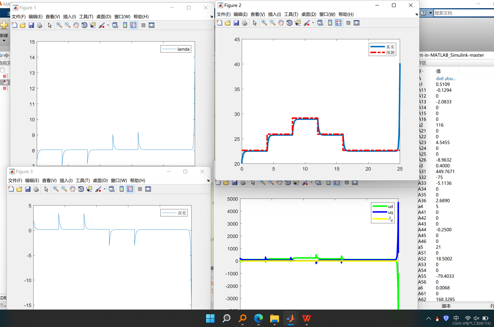
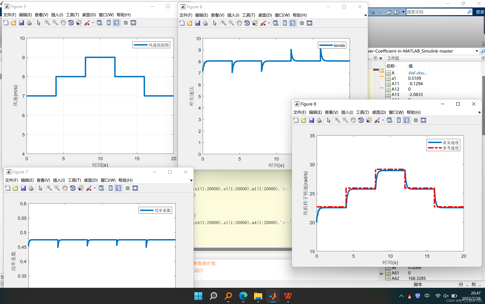
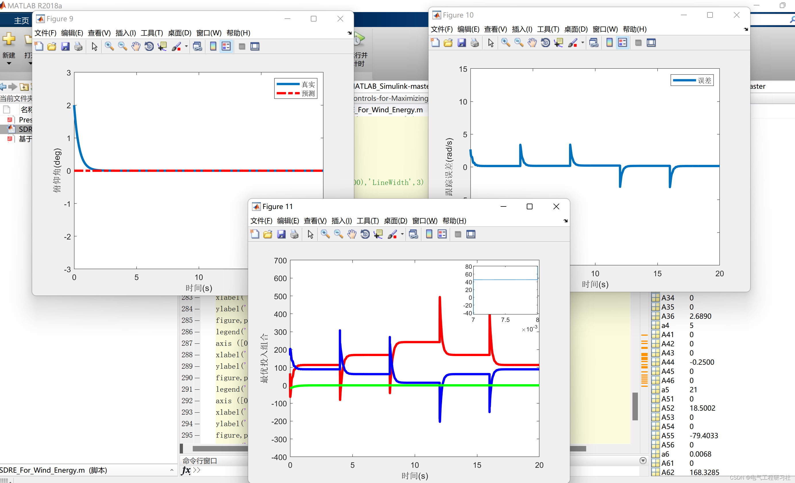
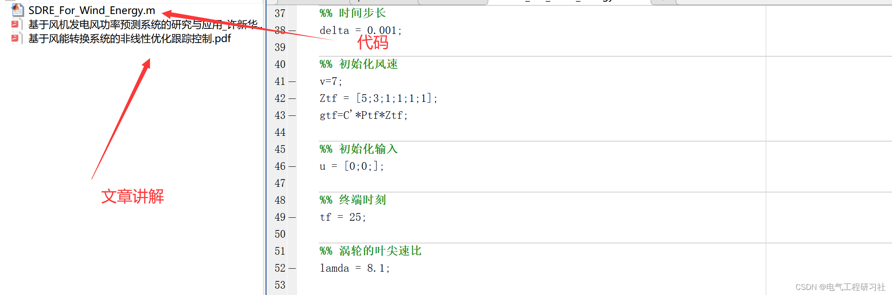

# Nonlinear Optimization Tracking Control Based on Wind Energy Conversion System (Matlab Code Implementation)

​  
📋📋📋This article is organized as follows: ⛳️⛳️⛳️Table of Contents: 1. Overview 2. Summary and Classification of Techniques for Wind Power Forecasting 2.1 Direct Methods and Indirect Methods 2.2 Physical Methods 3. Operational Results 4 MATLAB Code Implementation 5. Final Thoughts
2. Summary and Classification of Techniques for Wind Power Forecasting Technology Wind power power prediction technology for wind turbines.
The law is mainly divided into:
2.1 Direct and Indirect Methods The power forecasting of both direct and indirect methods is predicated on the mathematical model for prediction. Based on wind speed, the prediction of wind power generation is considered a direct method; whereas, predicting wind power based on power is an indirect method.
2.2 Physical Methods NWP Data is the main reference data for wind power forecasting systems. Based on this, factors such as the terrain of the wind farm, surface roughness of the wind farm, height of the wind turbine, and nearby obstacles need to be fully considered. In the prediction of medium and long-term wind power, it is also necessary to use the model object for prediction and determination, such as the wind turbine characteristic curve, mechanical rotation structure, and wind turbine control strategy, in order to improve the accuracy of the wind power forecasting system.
3. Operational Results Editing
Editing
4 Matlab Code Implementation
This article only displays part of the code, all codes can be found in:
Editing
5 End Notes Theoretical references are from online literature, if there is any infringement, please contact the blogger to delete.

## Images

<!-- PAYMENT_BLOCK -->

## Get this dataset

- Payment link (Stripe): [Buy now](https://buy.stripe.com/3cs8yP7sY87d0vu9AB)
- Payment QR code: 

<!-- /PAYMENT_BLOCK -->
